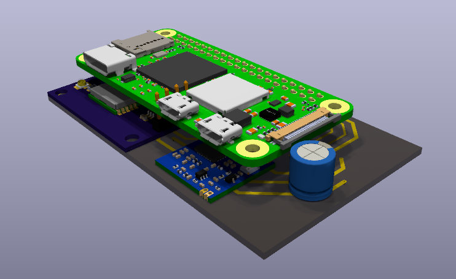
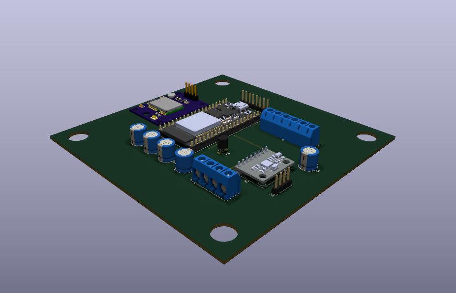
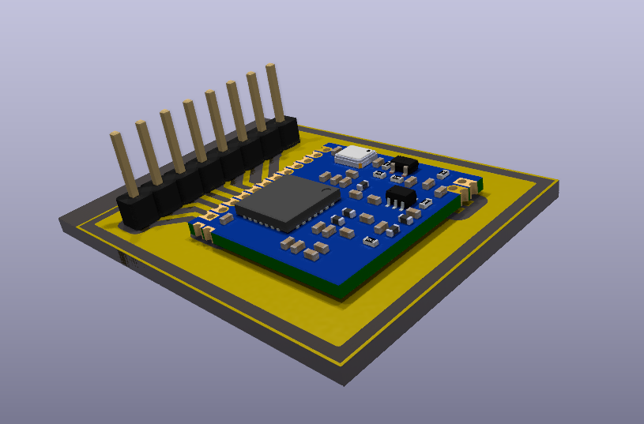
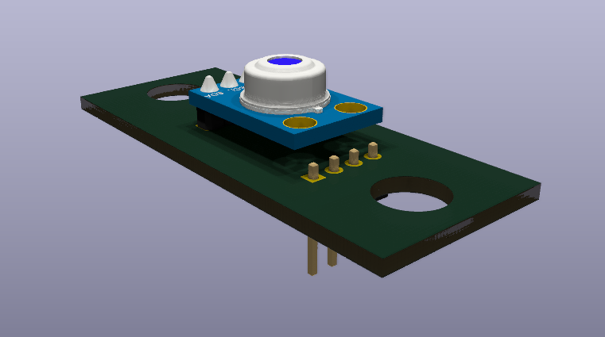
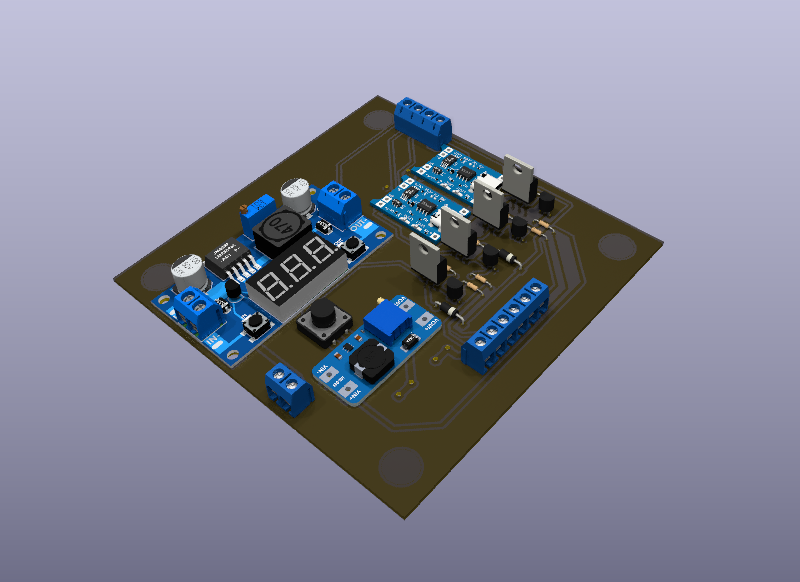

# Hardware

Esta carpeta contiene los diseños electrónicos del ecosistema AgroNomad desarrollados con KiCad. Incluye esquemáticos, placas PCB, proyectos de KiCad, vistas 3D y archivos de fabricación o impresión asociados a cada módulo.

El hardware se organiza en placas independientes según su función dentro del sistema:

- El **AgroBot** recibe los datos enviados por el AgroNeck.
- El **Cortex** constituye la lógica principal del collar AgroNeck.
- El **LoraShield**, el módulo MLX y el adaptador MOSFET son módulos auxiliares.
- El sistema **Solaria** administra la alimentación eléctrica mediante energía solar y baterías.

## Tipos de archivos

| Extensión | Descripción |
|---|---|
| `.kicad_sch` | Esquemático eléctrico: símbolos, conexiones y componentes de la placa. |
| `.kicad_pcb` | Diseño de la PCB: posición de componentes y trazado de pistas. |
| `.kicad_pro` | Archivo principal del proyecto de KiCad. |
| `.kicad_prl` | Configuración local de presentación o disposición del proyecto. |
| `*3D.png` | Vista renderizada del diseño tridimensional de la placa. |
| `*PCB.png` | Vista representativa del diseño o montaje de la PCB. |
| `fp-lib-table` / `sym-lib-table` | Tablas de bibliotecas locales de huellas y símbolos. |
| `libs/` | Bibliotecas, modelos 3D y recursos utilizados por el proyecto. |
| `gbr/` | Recursos relacionados con la preparación o trazado de fabricación. |

## Estructura

```text
hardware/
├── AgroBot/
├── Cortex/
├── LoraShield/
├── MLXModule/
├── MOSFETAdapter/
├── Solaria/
└── README.md
```

---

## AgroBot

El proyecto [`AgroBot/`](AgroBot/) corresponde a la estación de recepción fija del sistema.

**Función:** recibir la información emitida por los collares AgroNeck, determinar o conservar la ubicación mediante GPS y concentrar los datos para su procesamiento en el sistema principal.

<div align="center">
  
  <p><em>Diseño 3D del AgroBot</em></p>
</div>

El esquemático identifica una Raspberry Pi Zero 2 W como unidad de procesamiento, junto con módulos de comunicación LoRa y GPS.

| Archivo | Contenido |
|---|---|
| [`AgroBot.kicad_sch`](AgroBot/AgroBot.kicad_sch) | Esquemático del AgroBot. |
| [`AgroBot.kicad_pcb`](AgroBot/AgroBot.kicad_pcb) | Diseño físico y trazado de la PCB. |
| [`AgroBot.kicad_pro`](AgroBot/AgroBot.kicad_pro) | Proyecto de KiCad. |
| [`AgroBot3D.png`](AgroBot/AgroBot3D.png) | Representación tridimensional de la placa. |
| [`AgroBotPCB.png`](AgroBot/AgroBotPCB.png) | Vista de la PCB. |

---

## Cortex

El proyecto [`Cortex/`](Cortex/) representa la placa lógica principal del dispositivo AgroNeck, diseñado para instalarse dentro del collar inteligente.

**Función:** integrar el microcontrolador ESP32 con los módulos de comunicación y medición del collar. Procesa la información de posición y movimiento, comunica los datos por LoRa y gestiona las conexiones con los sensores.

<div align="center">
  
  <p><em>Diseño 3D de Cortex</em></p>
</div>

El esquemático contiene:

- ESP32 como unidad principal de procesamiento.
- Módulo GPS GY-NEO6MV2.
- Sensor MPU6050 para la detección de movimiento.
- Sensor MLX90614 para medición de temperatura.
- Interfaz de comunicación LoRa.
- Condensadores de desacoplo y conectores de alimentación o módulos auxiliares.

| Archivo | Contenido |
|---|---|
| [`Cortex.kicad_sch`](Cortex/Cortex.kicad_sch) | Esquemático de la lógica del AgroNeck. |
| [`Cortex.kicad_pcb`](Cortex/Cortex.kicad_pcb) | Diseño físico de la placa principal. |
| [`Cortex.kicad_pro`](Cortex/Cortex.kicad_pro) | Proyecto de KiCad. |
| [`Cortex3D.png`](Cortex/Cortex3D.png) | Vista tridimensional de Cortex. |
| [`CortexPCB.png`](Cortex/CortexPCB.png) | Vista de la PCB. |

---

## LoraShield

El proyecto [`LoraShield/`](LoraShield/) contiene una placa adaptadora basada en el módulo inalámbrico XL1278.

**Función:** proporcionar la interfaz física y eléctrica necesaria para conectar el módulo LoRa mediante conectores y facilitar su integración en el sistema.

<div align="center">
  
  <p><em>Diseño 3D del adaptador LoRa</em></p>
</div>

| Archivo | Contenido |
|---|---|
| [`LoraShield.kicad_sch`](LoraShield/LoraShield.kicad_sch) | Esquemático del adaptador LoRa. |
| [`LoraShield.kicad_pcb`](LoraShield/LoraShield.kicad_pcb) | Diseño físico de la placa. |
| [`LoraShield.kicad_pro`](LoraShield/LoraShield.kicad_pro) | Proyecto de KiCad. |
| [`LoraShield3D.png`](LoraShield/LoraShield3D.png) | Vista tridimensional del módulo. |
| [`LoraShieldPCB.png`](LoraShield/LoraShieldPCB.png) | Vista de la PCB. |

---

## MLXModule

El proyecto [`MLXModule/`](MLXModule/) corresponde a una placa auxiliar diseñada para el sensor infrarrojo de temperatura MLX90614.

**Función:** montar y conectar el sensor MLX90614 mediante un conector de cuatro posiciones, permitiendo llevar las señales de alimentación y comunicación entre el módulo y la placa Cortex.

<div align="center">
  
  <p><em>Módulo auxiliar del sensor MLX90614</em></p>
</div>

| Archivo | Contenido |
|---|---|
| [`MLXModule.kicad_sch`](MLXModule/MLXModule.kicad_sch) | Esquemático del módulo MLX90614. |
| [`MLXModule.kicad_pcb`](MLXModule/MLXModule.kicad_pcb) | Diseño físico de la placa auxiliar. |
| [`MLXModule.kicad_pro`](MLXModule/MLXModule.kicad_pro) | Proyecto de KiCad. |
| [`MLXModule3D.png`](MLXModule/MLXModule3D.png) | Vista tridimensional del módulo. |
| [`MLXModulePCB.png`](MLXModule/MLXModulePCB.png) | Vista de la PCB. |

---

## MOSFETAdapter

El proyecto [`MOSFETAdapter/`](MOSFETAdapter/) reúne un adaptador para trabajar con MOSFET en paquetes THT y SMD.

**Función:** facilitar el montaje y reemplazo de MOSFET en prototipos o placas donde se necesita compatibilidad entre formatos de componentes.

El diseño incluye los modelos **AO3401A** y **IRF9540N**, utilizados como dispositivos MOSFET en el proyecto.

| Archivo | Contenido |
|---|---|
| [`Adapter.kicad_sch`](MOSFETAdapter/Adapter.kicad_sch) | Esquemático del adaptador. |
| [`Adapter.kicad_pcb`](MOSFETAdapter/Adapter.kicad_pcb) | Diseño físico de la PCB. |
| [`Adapter.kicad_pro`](MOSFETAdapter/Adapter.kicad_pro) | Proyecto de KiCad. |
| [`Adapter3D.png`](MOSFETAdapter/Adapter3D.png) | Vista tridimensional del adaptador. |
| [`AdapterPCB.png`](MOSFETAdapter/AdapterPCB.png) | Vista de la PCB. |

---

## Solaria

El proyecto [`Solaria/`](Solaria/) corresponde al sistema electrónico de alimentación solar.

**Función:** administrar la energía captada por paneles solares, cargar baterías y elevar o distribuir la tensión necesaria para alimentar los dispositivos del sistema.

<div align="center">
  
  <p><em>Diseño 3D del sistema de alimentación</em></p>
</div>

El esquemático utiliza módulos TP4056 para la carga y gestión de baterías, junto con un conversor elevador MT3608 y MOSFET de potencia. La PCB incluye entradas y conexiones para panel solar, batería y carga.

| Archivo | Contenido |
|---|---|
| [`Solaria.kicad_sch`](Solaria/Solaria.kicad_sch) | Esquemático del sistema de alimentación. |
| [`Solaria.kicad_pcb`](Solaria/Solaria.kicad_pcb) | Diseño físico de la PCB. |
| [`Solaria.kicad_pro`](Solaria/Solaria.kicad_pro) | Proyecto de KiCad. |
| [`Solaria3D.png`](Solaria/Solaria3D.png) | Vista tridimensional de la placa. |
| [`SolariaPCB.png`](Solaria/SolariaPCB.png) | Vista de la PCB. |

## Abrir los diseños

1. Instalar una versión de KiCad compatible con los archivos del proyecto.
2. Abrir el archivo `.kicad_pro` correspondiente a la placa.
3. Desde el proyecto abrir `.kicad_sch` para revisar el circuito o `.kicad_pcb` para revisar el diseño físico.
4. Verificar las bibliotecas locales y los modelos 3D incluidos en `libs/` antes de modificar o exportar el diseño.