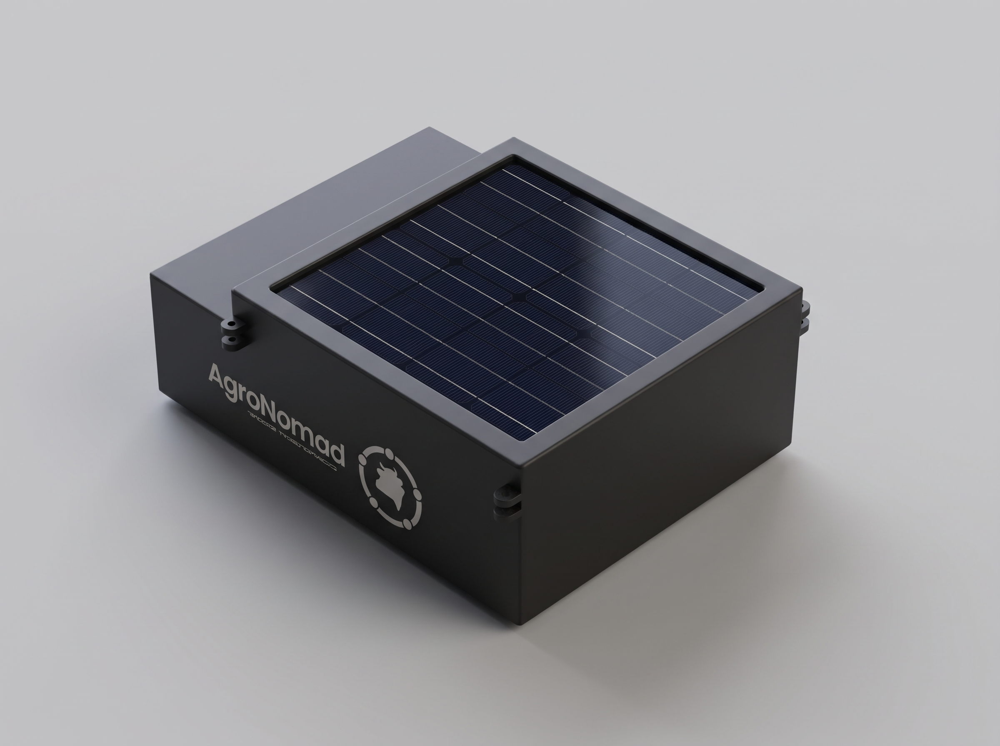
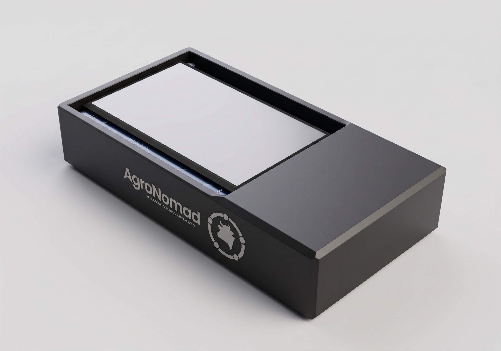

# Diseño mecánico

Esta carpeta contiene los modelos 3D y las imágenes de referencia de las carcasas desarrolladas para los dispositivos principales del proyecto AgroNomad: **AgroNeck** y **AgroBot**.

Los modelos permiten visualizar, fabricar y adaptar las estructuras físicas que alojan los componentes electrónicos. Junto con los esquemáticos y PCB ubicados en [`hardware/`](../hardware), forman parte del diseño integral de ambos dispositivos.

## Contenido de la carpeta

| Ruta | Contenido |
|---|---|
| [`Renders/`](Renders/) | Imágenes renderizadas de los diseños en su uso o presentación. |
| [`Step/`](Step/) | Archivos CAD exportados en formato STEP, listos para utilizarse en software compatible. |

```text
mechanical/
├── README.md
├── Renders/
│   ├── NeckUsuario.jpeg
│   └── BotUsuario.jpeg
└── Step/
    ├── AgroNeck.step
    └── AgroBot.step
```

## Renders

El directorio [`Renders/`](Renders/) contiene imágenes utilizadas como representación visual de las carcasas terminadas.

| Archivo | Descripción |
|---|---|
| [`NeckUsuario.jpeg`](Renders/NeckUsuario.jpeg) | Vista de la carcasa y el diseño mecánico de AgroNeck. |
| [`BotUsuario.jpeg`](Renders/BotUsuario.jpeg) | Vista de la carcasa y el diseño mecánico de AgroBot. |

### AgroNeck

AgroNeck es el collar inteligente colocado sobre el animal. Su diseño mecánico protege los componentes electrónicos y permite el montaje seguro de sensores, antenas y otros elementos necesarios para el monitoreo.

<div align="center">
  
</div>

### AgroBot

AgroBot es la estación de recepción fija del sistema. Su carcasa aloja la electrónica asociada a la recepción de datos y el control de la estación.

<div align="center">
  
</div>

## Archivos STEP

El directorio [`Step/`](Step/) contiene los modelos 3D en formato STEP (`.step`). Este formato tiene como finalidad facilitar el intercambio de modelos entre distintos programas de diseño asistido por computadora.

| Archivo | Contenido |
|---|---|
| [`AgroNeck.step`](Step/AgroNeck.step) | Modelo CAD de la carcasa de AgroNeck. |
| [`AgroBot.step`](Step/AgroBot.step) | Modelo CAD de la carcasa de AgroBot. |

Los archivos pueden importarse en software CAD compatible para:

- Revisar las dimensiones de las carcasas.
- Comprobar interferencias con los componentes electrónicos.
- Modificar el diseño para nuevas versiones.
- Exportar piezas a otros formatos.
- Preparar geometrías para impresión 3D o fabricación.

## Organización recomendada

Al realizar modificaciones se recomienda mantener esta separación:

- Colocar nuevas fotografías o vistas representativas dentro de `Renders/`.
- Conservar los modelos fuente o exportados en `Step/`.
- Utilizar nombres descriptivos que indiquen el componente y la versión del diseño.
- Actualizar este README cuando se agreguen nuevos modelos o formatos.
