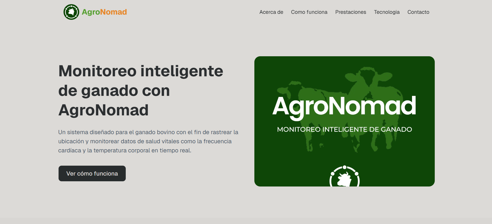

# AgroNomad - Landing Page

Landing page oficial del proyecto [AgroNomad](https://agro-nomad-page.vercel.app/), un sistema de monitoreo inteligente diseñado para el ganado bovino. El sitio presenta el ecosistema del proyecto, explica su funcionamiento y muestra las prestaciones, tecnología y formas de contacto.

El contenido está orientado a informar a productores, instituciones educativas y posibles colaboradores sobre cómo AgroNomad combina hardware, comunicaciones inalámbricas y una interfaz web para obtener datos sobre la ubicación y la salud del ganado.

<div align="center">
  
</div>

## Sitio publicado

- **Producción:** [agro-nomad-page.vercel.app](https://agro-nomad-page.vercel.app/)
- **Contacto:** [nomadbusiness2026@gmail.com](mailto:nomadbusiness2026@gmail.com)
- **Instagram:** [@proyecto.agronomad](https://www.instagram.com/proyecto.agronomad/)
- **TikTok:** [@proyecto.agronomad](https://www.tiktok.com/@proyecto.agronomad)

## Qué describe la página

La interfaz está organizada en secciones accesibles desde la navegación principal:

- **Acerca de:** presenta la finalidad de AgroNomad y los datos que busca monitorear.
- **Descripción:** explica el flujo general desde el collar inteligente hasta la interfaz web.
- **Funcionamiento:** describe los tres componentes principales del ecosistema:
  - **AgroNeck:** collar que recolecta datos del animal y los transmite.
  - **AgroBot:** estación de recepción que procesa y centraliza la información.
  - **Interfaz de usuario:** muestra los datos y permite su consulta.
- **Prestaciones:** destaca la alimentación solar, la medición de temperatura, la comunicación LoRa y el seguimiento GPS.
- **Tecnología:** enumera los componentes electrónicos y sistemas de comunicación utilizados.
- **Contacto:** muestra la ubicación, el correo electrónico y las redes sociales del proyecto.

También incluye una vista responsiva para dispositivos móviles, carruseles de imágenes y un selector de tema claro u oscuro que guarda la preferencia del usuario en el navegador.

## Desarrollo

La landing page fue desarrollada como una aplicación web de una sola página en React. El punto de entrada monta `App.jsx`, que renderiza el componente principal `AgroNomadLanding.jsx`.

Las secciones se conectan mediante enlaces con anclas a sus identificadores. Los datos y contenidos se muestran mediante componentes reutilizables con Tailwind CSS, mientras que la navegación, los carruseles y la selección de tema se implementan con estado y efectos de React.

Los recursos gráficos se mantienen dentro de `src/assets`, y el favicon y el logo utilizado fuera del componente también se sirven desde `public`.

### Tecnologías utilizadas

| Tecnología | Uso en el proyecto |
|---|---|
| **React 19** | Construcción de la interfaz por componentes y gestión del estado. |
| **Vite** | Entorno de desarrollo rápido y generación del paquete de producción. |
| **JavaScript / JSX** | Implementación de componentes, interacciones y estructura de la aplicación. |
| **Tailwind CSS 4** | Estilos responsivos, tema claro/oscuro y diseño visual. |
| **shadcn/ui** | Base de componentes reutilizables para tarjetas y controles. |
| **Radix UI** | Primitivos accesibles utilizados por los componentes de la interfaz. |
| **Lucide React** | Iconografía SVG utilizada en prestaciones y etapas del sistema. |
| **Geist** | Tipografía principal incluida mediante Fontsource. |
| **ESLint** | Revisión de errores y buenas prácticas en el código JavaScript. |
| **React Compiler** | Optimización automática aplicada durante el proceso de compilación. |
| **Vercel** | Publicación y alojamiento del sitio web. |

## Ejecutar el proyecto localmente

### Requisitos previos

- Node.js
- npm

### Instalación

Desde la carpeta `web`:

```bash
npm install
```

### Servidor de desarrollo

```bash
npm run dev
```

Vite mostrará la URL local en la terminal, normalmente `http://localhost:5173`.

### Compilación de producción

```bash
npm run build
```

La salida optimizada se genera en la carpeta `dist`.

### Vista previa de la compilación

```bash
npm run preview
```

### Análisis con ESLint

```bash
npm run lint
```

## Estructura del directorio

```text
web/
├── public/                    # Archivos públicos e imágenes directas
│   └── logo.jpeg
├── src/
│   ├── assets/
│   │   ├── agronomad/         # Fotografías y presentaciones
│   │   └── logos/             # Logotipos de redes y servicios
│   ├── components/ui/
│   │   ├── button.jsx         # Variante reutilizable de botón
│   │   ├── card.jsx           # Componentes de tarjetas
│   │   └── darkMode.jsx       # Control de tema claro/oscuro
│   ├── lib/
│   ├── AgroNomadLanding.jsx   # Contenido y secciones principales
│   ├── App.jsx                # Composición de la aplicación
│   ├── index.css              # Imports y variables de Tailwind
│   └── main.jsx               # Punto de entrada de React
├── index.html
├── package.json
├── vite.config.js
└── PaginaPreview.png
```

## Características implementadas

- Diseño adaptable para escritorio y dispositivos móviles.
- Navegación interna suave entre las secciones.
- Carrusel automático de imágenes.
- Carrusel interactivo del funcionamiento del sistema.
- Modo claro y modo oscuro.
- Persistencia del tema seleccionado mediante `localStorage`.
- Preferencia de tema según el sistema cuando no existe una selección previa.
- Enlaces externos seguros para redes sociales, ubicación y correo electrónico.
- Accesibilidad básica mediante etiquetas alternativas en imágenes y relaciones semánticas de navegación.

---